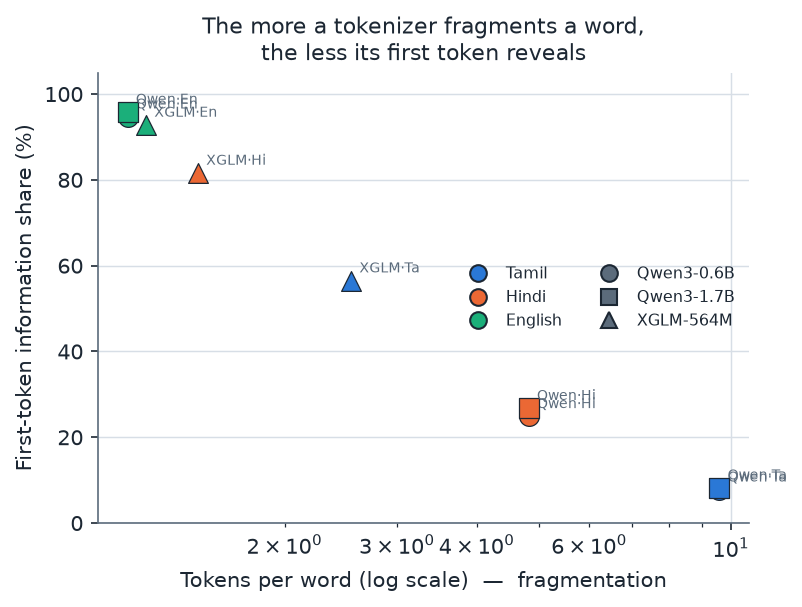
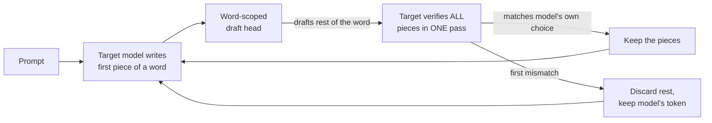
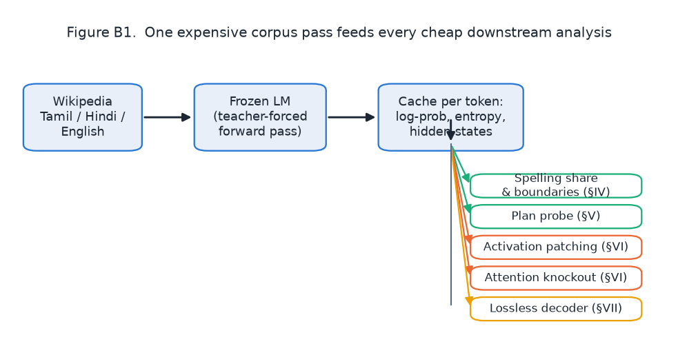
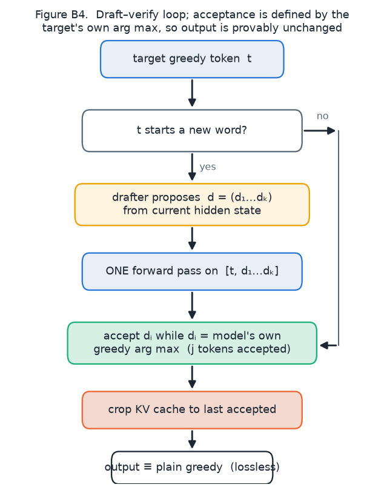
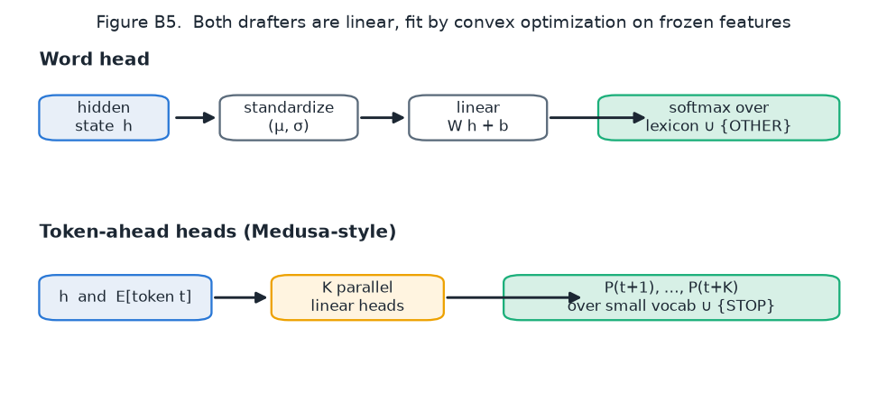
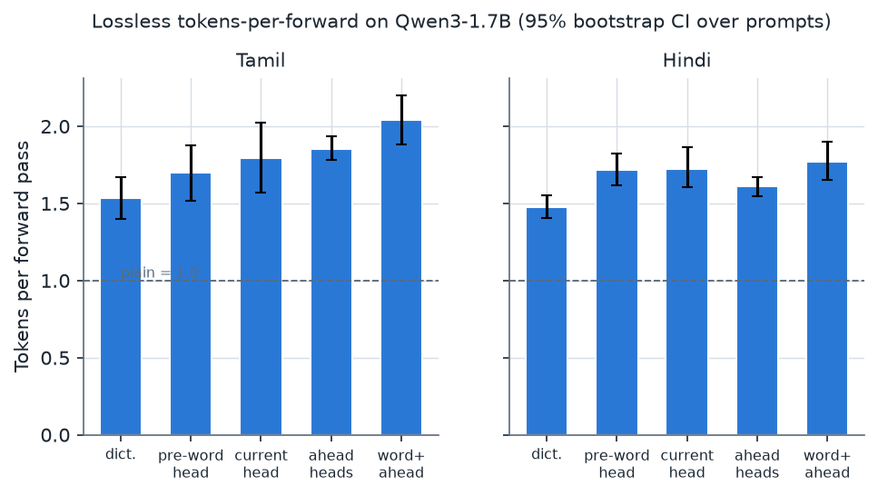
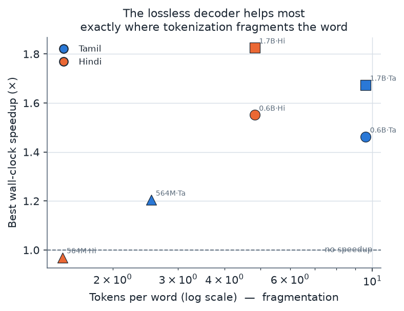
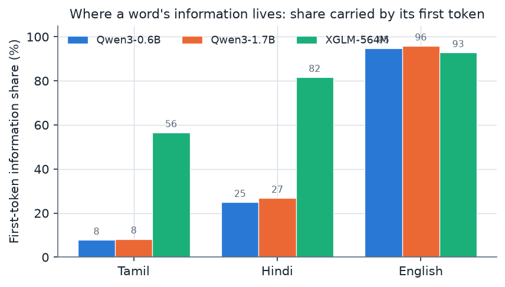

<div align="center">

# TokenLift

### Lossless word-level speculative decoding for Indic-script LLMs

**Faster Tamil & Hindi generation — output identical to the model's own, on a laptop.**

[](LICENSE)


[Install](#install) · [Quickstart](#quickstart) · [How it works](#how-it-works) · [Results](#results) · [Novelty](#whats-new) · [Use cases](#use-cases)

</div>

---

## The problem in one picture

Large language models read text as **tokens**. For English, a token is usually a whole word. For
Tamil and Hindi, a byte-level BPE tokenizer (like Qwen3's) shatters one word into many pieces:

<div align="center"></div>

| | Tokens per word | Information in the **first** token |
| --- | ---: | ---: |
| English | 1.14 | 94.7% |
| Hindi | 4.82 | 24.9% |
| Tamil | **9.59** | **7.7%** |

A Tamil word is ~9 model steps long, and most of those steps are just **spelling out** a word the
model has effectively already chosen. Each step is a full forward pass. That is wasted latency —
exactly where TokenLift steps in.

## What TokenLift does

TokenLift trains a tiny **word-scoped draft head** that guesses the rest of a word in one shot, and
lets the target model **verify** the guess in a single forward pass. It keeps only the tokens the
model would have produced anyway, so:

- **Greedy output is bit-identical** to the model's own greedy decoding (in float32).
- **Sampling output** is drawn from the model's exact temperature distribution (standard
  speculative-sampling rule).
- **Comprehension is untouched** — the model always reads its own original sub-word tokens.

It runs on a MacBook (Apple MPS), CUDA, or CPU. Training a head takes a few minutes.

## Install

```bash
git clone https://github.com/rochitl72/tokenlift.git
cd tokenlift
python3.11 -m venv venv && source venv/bin/activate
pip install -e ".[dev]"
pytest                      # runs the losslessness + tokenization tests
```

## Quickstart

```python
from tokenlift import TokenLift

# float32 by default → greedy output is bit-identical to the model's own
spec = TokenLift.from_pretrained("Qwen/Qwen3-0.6B-Base")

# train a small word-scoped head per language on your own records (one time)
spec.fit(langs=["ta"], records_fn=my_records, epochs=30)
spec.save_head("ta", "head_ta.pt")

# later: load and generate
spec.load_head("ta", "head_ta.pt")
out = spec.generate("தமிழ்நாட்டின் தலைநகரம்", max_new=64, lang="ta")
print(out["text"], out["tokens_per_forward"])

# lossless speculative sampling (preserves the target's T-sampled distribution)
print(spec.sample("தமிழ்நாட்டின் தலைநகரம்", max_new=64, temperature=0.8, lang="ta")["text"])
```

### Command line

```bash
# How much headroom does a model have on YOUR text? (no training needed)
tokenlift report --model Qwen/Qwen3-0.6B-Base --text-file samples_ta.txt

# Generate from a trained head (temperature 0 = greedy, >0 = sampling)
tokenlift gen --model Qwen/Qwen3-0.6B-Base --lang ta --head head_ta.pt \
              --prompt "தமிழ்நாட்டின் தலைநகரம்" --temperature 0.8
```

> **Note on `fit()`** — a head learns from per-word hidden-state *records*. Pass your own
> `records_fn` (build it with `wordhead.corpus.run_corpus` over your text). The `report` command
> and the headroom diagnostic need no training and work out of the box.

## How it works



<div align="center">


</div>

1. A **word boundary** is detected in the token stream.
2. The **EAGLE-style head** reads the target's hidden state + current token embedding and
   autoregressively drafts the remaining tokens of the word.
3. `[first_token] + draft` is **verified in one target forward pass**; accepted tokens are
   committed and the KV cache is cropped at the first rejection.

Because acceptance is defined by the target model's own arg-max, the result is identical to plain
greedy decoding *by construction* — a wrong draft costs a little time, never correctness.

<div align="center"></div>

## Results

Real lossless greedy decoding, 24 held-out prompts × 64 new tokens, on a MacBook M1 Pro.
**tok/fwd** = accepted tokens per forward pass (hardware-independent quality signal);
**wall** = wall-clock speedup over plain decoding.

| Model | Language | Decoder | tok/fwd | wall |
| --- | --- | --- | ---: | ---: |
| 0.6B | Tamil | TokenLift head | **2.15** | ×1.41 |
| 0.6B | Hindi | TokenLift head | **1.82** | ×1.40 |
| 1.7B | Tamil | TokenLift head | **2.26** | ×1.84 |
| 1.7B | Hindi | TokenLift head | **1.86** | ×2.10 |
| 4.0B | Tamil | TokenLift head | **2.23** | ×1.73 |
| 4.0B | Hindi | TokenLift head | **1.98** | ×2.09 |

The learned head beats a context-blind dictionary baseline on every model and language. The
wall-clock payoff is modest at 0.6B and larger at 1.7B–4B (the head's fixed cost is amortized
against a heavier base forward pass), then **plateaus** — it does not keep growing without bound.

<div align="center">


</div>

**The gain tracks fragmentation.** On XGLM-564M, whose tokenizer barely splits Indic words, the
same decoder gives essentially no speedup — there is little within-word structure to draft. The
method is a remedy for fragmentation, and helps most exactly where byte-BPE hurts most.

### Lossless speculative sampling (Qwen3-0.6B, Tamil)

| Temperature | tok/fwd | acceptance |
| --- | ---: | ---: |
| τ = 0.7 | 2.32 | 28.2% |
| τ = 1.0 | 2.09 | 24.7% |

## Why "lossless"?

- Every drafted token is kept **only if** it equals the target model's own arg-max at that position.
- In **float32**, output matched plain greedy token-for-token in our checks.
- In **float16** (the fast default on Apple GPUs), rounding can flip *near-tied* logits with batch
  shape, so a fast run may differ from a plain run at a tie. That is floating-point arithmetic, not
  the method — `from_pretrained(..., dtype="float32")` (the default) gives strict bit-identity.

## What's new

<div align="center"></div>

TokenLift is, to our knowledge, **the first speculative decoder scoped to the *word* as the unit
that tokenization fragments**, and the first to target Indic generation specifically. Three pieces:

1. **A measurement.** We quantify *where* a word's information lives inside a fragmented token
   sequence — for Tamil only ~8% is in the first token, versus ~95% for English.
2. **A mechanism.** Probing, activation patching and attention knockout show the upcoming word is
   partly *readable* in advance but is *re-derived from context* as it is spelled — it is not fixed
   early. This both motivates and bounds the decoder.
3. **A tool.** A lossless, laptop-trainable word-scoped EAGLE head plus a **headroom diagnostic**
   that predicts achievable speedup for *any* model and script from two measured quantities
   (tokens-per-word and greedy continuation predictability) — so you can decide whether to train a
   head without training one.

## Use cases

- **Cheaper Indic inference.** Speed up Tamil/Hindi generation on existing Qwen3-class models with
  zero change to output — useful for chatbots, assistants, and batch generation at batch size 1.
- **Any heavily-fragmented script.** The idea applies to Telugu, Kannada, Bengali, Malayalam,
  Arabic, and more. Run `tokenlift report` to estimate the headroom on your own text and model.
- **A tokenizer-quality probe.** The headroom diagnostic is a quick, training-free way to measure
  how badly a tokenizer fragments a language — handy when choosing or evaluating a model for an
  Indic deployment.
- **A research substrate.** The word-scoped head and the probing/patching utilities are reusable
  for studying where sub-word models "decide" a word.

## Limitations

- Speedup is measured at **batch size 1 on MPS**; on CPU the extra draft tokens are not free and
  the decoder can be slower than plain decoding.
- Evaluated on **Tamil and Hindi**, Wikipedia text, Qwen3-family (byte-BPE) tokenizers.
- A lexicon head cannot draft a word it has never seen (held-out Tamil lexicon coverage ≈ 39%);
  token-ahead heads mitigate this but the emulated oracle shows headroom remains.

## Paper & citation

This tool is the companion to a research paper (mechanistic analysis + decoder). Full write-up,
figures and the complete research code live in the
**[research-paper repository](https://github.com/rochitl72/research-paper)**.

```bibtex
@misc{tokenlift2026,
  title  = {TokenLift: Exploiting Latent Word Plans for Exact Word-Level Speculative
            Decoding in Byte-BPE Indic Language Models},
  author = {L., Rochit and Adith Sree Jey, A. S. and Hari Krishna, D. and
            Pranavaswaruban, S. and Santhosh, Muruggu and Mithilesh, B.},
  year   = {2026},
  url    = {https://github.com/rochitl72/tokenlift}
}
```

**Authors:** Rochit L. (lead, corresponding — rochitl72@gmail.com), Adith Sree Jey A S,
Hari Krishna D, Pranavaswaruban S, Santhosh Muruggu, Mithilesh B.

## License

MIT — see [LICENSE](LICENSE). Figures in `assets/` are from the companion paper by the same authors.
